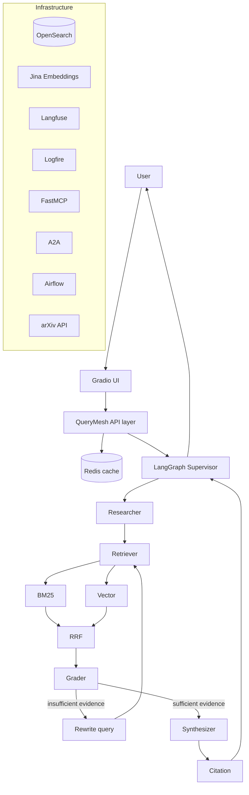

# QueryMesh

A production-grade multi-agent research assistant for arXiv: ask a question
about scientific research, and QueryMesh plans searches, retrieves and
grades evidence via hybrid (BM25 + vector) search, and synthesizes a
grounded, cited answer — built incrementally with LangGraph, FastMCP,
A2A-style agent communication, OpenSearch, Jina embeddings, and full
observability (Logfire + Langfuse).

> **Status:** All 30 phases complete. See [Roadmap](#roadmap).

## Features

- **Hybrid retrieval**: BM25 + vector search fused with Reciprocal Rank Fusion
- **Five specialized agents**: researcher (query planning), retriever, grader,
  synthesizer, citation verification — orchestrated by a LangGraph
  supervisor/worker graph with a bounded, query-rewriting retry loop
- **Grounded, cited answers**: the synthesis agent never invents facts or
  citations; every citation is independently verified against retrieved evidence
- **Agent discovery & communication**: an in-process `AgentRegistry`
  (capability-based lookup) plus an `A2AClient` (message envelope, retries,
  loop prevention) for agent-to-agent delegation
- **FastMCP tool servers**: each agent's capability is exposed as an MCP tool,
  independently callable, with optional bearer-token auth
- **Streaming**: token-level LLM output and structured workflow events
  (`workflow_started`, `retrieval_completed`, `token`, `citation`, ...)
- **Observability**: Logfire + Langfuse tracing with the exact hierarchy
  `research_request → researcher / retrieval(bm25/vector/rrf) / grader /
  synthesis / citation`, cache hit/miss tracking
- **Redis caching**: SHA256-keyed exact-match answer cache, never caches
  failed/incomplete responses
- **Continuous ingestion**: an Airflow DAG for incremental arXiv ingestion
  (own container, own minimal deps — see [Airflow](#running-airflow))
- **Gradio UI**: query input, live execution status, streaming answer,
  citations, retrieved papers
- **Evaluated**: retrieval (Precision@K, Recall@K, MRR, NDCG) and generation
  (faithfulness, relevance, citation correctness/completeness) benchmarks
  against real component composition, not illustrative examples
- **Production-hardened**: unified error hierarchy with retryable/
  non-retryable distinction, input validation (max query length, max
  document count), bounded graph recursion, pinned dependencies, non-root
  Docker image with health checks

## Architecture



Each agent's capability is also independently reachable as a FastMCP tool
(`search_papers`, `retrieve_documents`, `grade_documents`, `generate_answer`,
`verify_citations`) and via the in-process `A2AClient` — the graph above is
the default orchestration path, not the only way to invoke an agent.

## Repository Structure

```
querymesh/
├── agents/          # Five specialized agents (researcher, retriever, grader, synthesizer, citation)
├── graph/           # LangGraph state, nodes, edges, workflow, streaming events
├── retrieval/        # BM25, vector, hybrid (RRF) retrieval, RetrievalService facade
├── ingestion/         # arXiv client, PDF downloader, Docling/Fake parser, chunker
├── indexing/          # OpenSearch connection, mappings, bulk indexer
├── embeddings/        # Jina + Fake embedders behind a shared Embedder protocol
├── llm/                # LLM abstraction (Fake + Ollama providers)
├── mcp/servers/         # FastMCP tool servers, one per agent
├── a2a/                  # Agent registry (discovery) + A2A message protocol/client
├── cache/                 # Redis exact-match response cache
├── observability/          # Logging, Logfire/Langfuse tracing, timing utility
├── evaluation/              # Retrieval + generation evaluation metrics and harnesses
├── security/                 # Input validation limits, MCP bearer-token auth
├── errors.py                   # Project-wide exception hierarchy
├── api/                          # (placeholder — no public API endpoint built yet)
├── ui/                             # Gradio UI (handlers separate from widget wiring)
├── config/                          # Centralized Pydantic settings
└── airflow/dags/                     # Ingestion DAG (own container — see below)
tests/
├── unit/            # ~300 tests, fast, isolated, fake doubles throughout
├── integration/     # Real component composition, only the network boundary faked
└── evaluation/      # Real retrieval/generation/performance benchmarks
scripts/             # health_check.py
docker/              # Dockerfile (multi-stage, non-root, health-checked)
docker-compose.yml    # querymesh + opensearch + redis + airflow
requirements-lock.txt  # Pinned runtime dependencies
```

## Installation

Requires Python 3.12+.

```bash
python -m venv .venv
source .venv/bin/activate
pip install -e ".[dev]"
cp .env.example .env
```

Docling (PDF parsing) is a heavy, optional extra — install separately if you
need real PDF parsing rather than the `FakeParser` used by default:
```bash
pip install -e ".[docling]"
```

## Environment Variables

See [`.env.example`](.env.example) for the full list. Every external
service (LLM, OpenSearch, Jina, Redis, Langfuse, Logfire) is optional —
QueryMesh runs with `Fake*` implementations of each abstraction (`LLM`,
`Embedder`, tracer) when unconfigured, so the whole pipeline is runnable
and testable with zero credentials.

## Local Development

Run the health check:
```bash
python -m querymesh health
# or
python scripts/health_check.py
```

Run the Gradio UI:
```python
from querymesh.ui import main
main()  # http://127.0.0.1:7860
```

### Running OpenSearch
```bash
docker run -p 9200:9200 -e discovery.type=single-node \
  -e plugins.security.disabled=true opensearchproject/opensearch:2.17.0
```
Or via `docker compose up opensearch` (see [Deployment](#deployment-docker)).

### Running Redis
```bash
docker run -p 6379:6379 redis:7-alpine
```

### Running ingestion
```python
from querymesh.ingestion import ArxivClient, PdfDownloader, IngestionPipeline, FakeParser, PaperChunker
from querymesh.indexing import ChunkIndexer, OpenSearchConnection, build_client
from querymesh.embeddings import get_embedder

async with ArxivClient() as client:
    papers = await client.search("transformer attention", max_results=20)

downloader = PdfDownloader(storage_dir="./data/pdfs")
pipeline = IngestionPipeline(downloader=downloader, parser=FakeParser())  # or DoclingParser()
docs = await pipeline.process_many(papers)

chunker = PaperChunker(max_chars=1200)
chunks = [c for doc in docs for c in chunker.chunk(doc)]

conn = OpenSearchConnection(client=build_client(), index_name="querymesh-papers")
await conn.create_index()
await ChunkIndexer(connection=conn, embedder=get_embedder()).index_chunks(chunks)
```

### Running agents
```python
from querymesh.agents import ResearcherAgent, RetrieverAgent, GraderAgent, SynthesizerAgent, CitationAgent
from querymesh.llm import get_llm
from querymesh.retrieval import RetrievalService  # see below

llm = get_llm()
researcher = ResearcherAgent(llm)
plan = await researcher.plan("What are the limitations of RAG?")
```

### Running MCP servers
```python
from querymesh.mcp.servers import build_research_server
from querymesh.security.mcp_auth import StaticBearerTokenVerifier

server = build_research_server(researcher, auth=StaticBearerTokenVerifier("your-token"))  # auth optional
server.run(transport="sse", host="127.0.0.1", port=8765)
```

### Running A2A
```python
from querymesh.a2a import A2AClient, build_default_registry

registry = build_default_registry(researcher, retriever, grader, synthesizer, citation)
client = A2AClient()
client.register_handler("grader", lambda payload: grader.grade_and_filter(payload["query"], payload["docs"]))
response = await client.send(sender="supervisor", recipient="grader", task="grade", payload={...})
```

### Running LangGraph
```python
from querymesh.graph import compile_workflow, create_initial_state, run_research_workflow

compiled = compile_workflow(llm=llm, retrieval_service=retrieval_service)
result = await run_research_workflow(compiled, create_initial_state("What are RAG's limitations?"))
print(result["answer"], result["citations"])
```

### Running Gradio
```python
from querymesh.ui import main
main()
```

### Running Airflow

Airflow runs in **its own container/environment** — never installed
alongside the main application. Real, verified conflicts exist between
Airflow's pinned dependencies (opentelemetry, typing-extensions,
cryptography) and QueryMesh's (pydantic 2.13, logfire, langfuse, langgraph,
fastmcp). See `querymesh/airflow/requirements.txt` for the full explanation
and the verified-working isolated setup (`pip install apache-airflow==2.10.5
--constraint ... && pip install pydantic pydantic-settings
"opensearch-py[async]" python-dotenv`, with the repo on `PYTHONPATH` —
**not** `pip install -e .`). Easiest path: `docker compose up airflow`,
which does this automatically.

### Running tests
```bash
pytest -v                    # everything (359 tests)
pytest -m unit -v            # unit only — fast, fully isolated
pytest -m integration -v     # integration — real component composition
pytest -m evaluation -s -v   # real benchmarks, with metrics/latency printed
```

## Evaluation

```python
from querymesh.evaluation import compare_retrieval_methods, EvaluationCase

report = await compare_retrieval_methods(bm25, vector, hybrid, embedder, dataset)
print(report.bm25.mrr, report.vector.mrr, report.hybrid.mrr)
```
```python
from querymesh.evaluation import GenerationEvalCase, GenerationJudge, evaluate_generation_case

case = GenerationEvalCase(query="...", answer="...", evidence=[...], citations=[...])
result = await evaluate_generation_case(case, judge=GenerationJudge(judge_llm))  # judge_llm separate from production LLM
```
See `tests/evaluation/` for real benchmarks run against genuine (if
sandboxed/faked-at-the-network-boundary) component composition, not
hand-crafted examples.

## Observability

```python
from querymesh.observability import get_tracer
from querymesh.graph import compile_workflow, run_research_workflow

tracer = get_tracer()  # NoOp unless LOGFIRE_TOKEN / LANGFUSE_PUBLIC_KEY+SECRET_KEY are set
compiled = compile_workflow(llm=llm, retrieval_service=retrieval_service, tracer=tracer)
result = await run_research_workflow(compiled, state, tracer=tracer)
```
Tracing hierarchy: `research_request → researcher / retrieval (→ bm25, vector,
rrf) / grader / synthesis / citation`, plus `cache` spans with `cache_hit`/
`cache_miss`. Secrets are never captured as span attributes (`scrub_attributes`).

## Deployment (Docker)

```bash
cp .env.example .env   # fill in LLM_API_KEY / JINA_API_KEY / etc.
docker compose up
```

Starts OpenSearch (`:9200`), Redis (`:6379`), the QueryMesh Gradio UI
(`:7860`), and Airflow standalone (`:8080`). Jina, Langfuse, Logfire, and
arXiv are external services reached over the network via `.env` — never
containerized. See `docker/Dockerfile` (multi-stage, non-root, pinned via
`requirements-lock.txt`, baked-in `HEALTHCHECK`) and `docker-compose.yml`.

## Production Security

- Input validation: `MAX_QUERY_LENGTH` (2000 chars), `MAX_TOP_K` (100
  documents), enforced at `create_initial_state()` and `RetrievalService.retrieve()`
- Graph recursion bounded explicitly (`recursion_limit`) as defense in depth
  beyond the retry-count logic
- MCP servers support optional static bearer-token auth
  (`querymesh.security.mcp_auth.StaticBearerTokenVerifier`)
- Every error descends from `QueryMeshError` with a `retryable: bool` — see
  `querymesh/errors.py`
- No secrets ever logged; every outbound HTTP client has a timeout
- Dependencies pinned exactly in `requirements-lock.txt`, used by the Docker build

## Roadmap

- [x] Phase 0 — Project architecture
- [x] Phase 1 — Configuration & LLM abstraction
- [x] Phase 2 — arXiv ingestion
- [x] Phase 3 — PDF download & Docling
- [x] Phase 4 — Document chunking
- [x] Phase 5 — OpenSearch
- [x] Phase 6 — BM25 retrieval
- [x] Phase 7 — Jina vector embeddings
- [x] Phase 8 — Vector search
- [x] Phase 9 — Reciprocal rank fusion
- [x] Phase 10 — Retrieval service
- [x] Phase 11 — Specialized agents
- [x] Phase 12 — LangGraph state
- [x] Phase 13 — LangGraph supervisor/worker
- [x] Phase 14 — Advanced agentic RAG
- [x] Phase 15 — Agent discovery
- [x] Phase 16 — FastMCP
- [x] Phase 17 — A2A communication
- [x] Phase 18 — Observability (Logfire + Langfuse)
- [x] Phase 19 — Redis caching
- [x] Phase 20 — Airflow ingestion
- [x] Phase 21 — Gradio UI
- [x] Phase 22 — Streaming
- [x] Phase 23 — Error handling
- [x] Phase 24 — Testing
- [x] Phase 25 — Retrieval evaluation
- [x] Phase 26 — Generation evaluation
- [x] Phase 27 — Performance
- [x] Phase 28 — Dockerization
- [x] Phase 29 — Production security
- [x] Phase 30 — Final production polish

## Troubleshooting

**`pip install docling` fails or fills disk** — Docling pulls in
torch/transformers/opencv (multi-GB). It's an optional extra
(`pip install -e ".[docling]"`) for exactly this reason; `FakeParser` works
for everything except real PDF structure extraction.

**Airflow install conflicts with the main app** — expected; see
[Running Airflow](#running-airflow) above. Never `pip install -e .` (the
querymesh package) into an Airflow environment.

**OpenSearch/Redis connection errors** — every retrieval/cache object takes
its client via dependency injection (`build_client()`/`build_redis_client()`
read `OPENSEARCH_URL`/`REDIS_URL` from `.env`); without those set, code
using the real clients will raise `ConfigurationError`/`CacheError` rather
than silently trying `localhost`.

**Tests failing after a dependency change** — regenerate
`requirements-lock.txt` (see the header comment in that file for the exact
command) and re-run the full suite before trusting the new lock.

**Something in this README looks stale** — the roadmap above should always
show all 30 phases checked; if it doesn't, or if a documented command
doesn't match what a phase's `PHASE STATUS` report said, treat the phase
report as source of truth and open a documentation fix.
